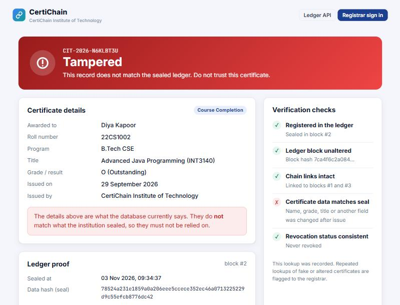
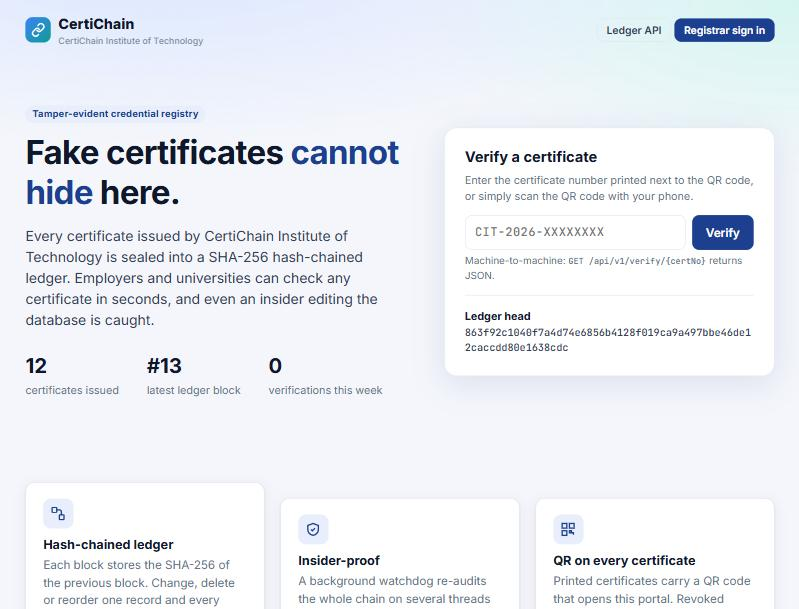
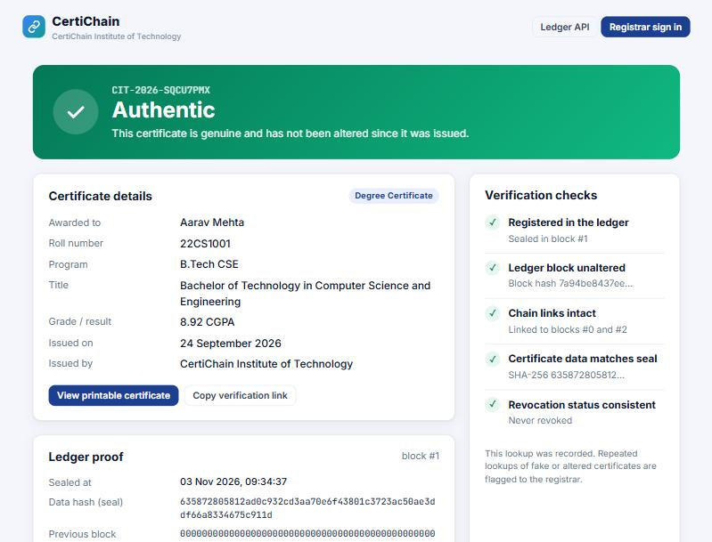
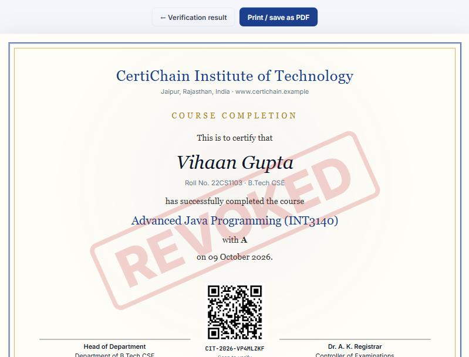
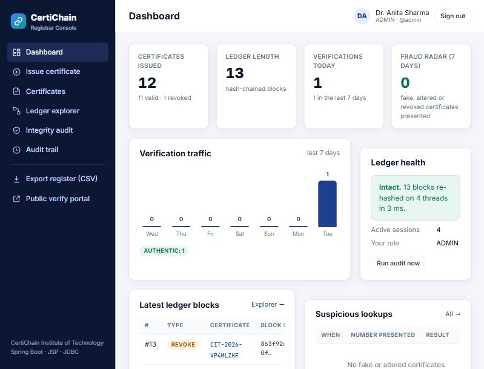
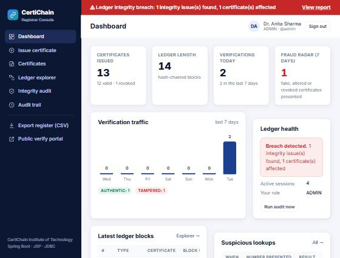
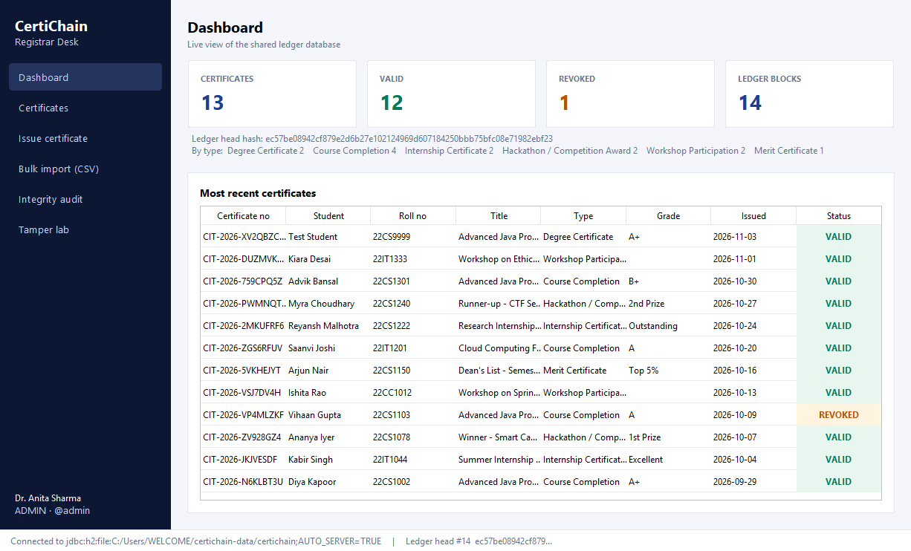
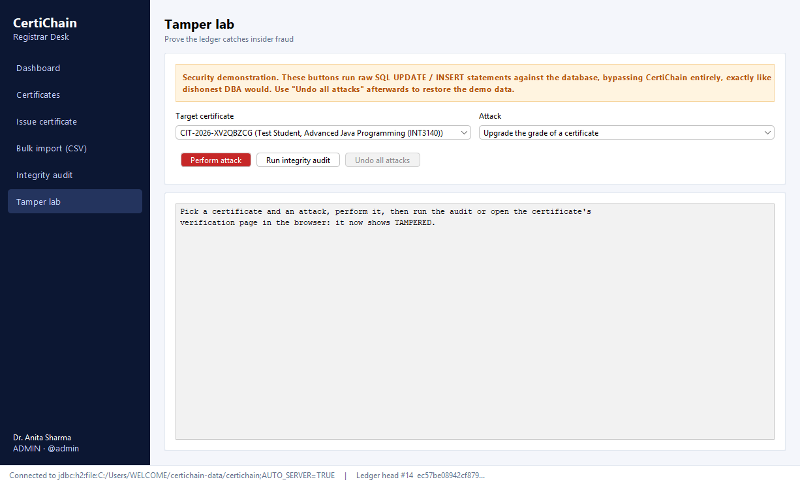
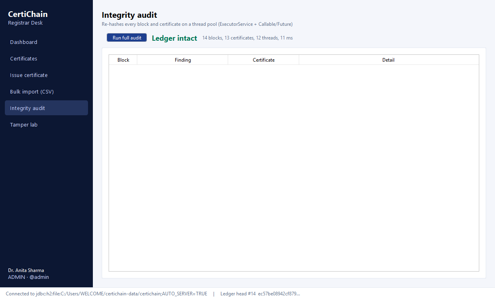

# CertiChain: a tamper-evident academic credential registry

**Advanced Java (INT3140) project · B.Tech CSE, III year / V sem · 2026-27**

CertiChain lets an institution issue academic certificates (degrees, course completions,
internships, hackathon awards...) that **anyone can verify in seconds**, and that **cannot be
faked or quietly edited, even by someone with direct access to the database**.

Every certificate is sealed into a **SHA-256 hash-chained ledger** stored in an ordinary
relational database. Each ledger block contains the hash of the previous block, like a
blockchain but without cryptocurrency or mining. Change one grade with an SQL `UPDATE`,
delete a row, or slip a forged degree into the table, and the chain no longer adds up. The
public verification page, the background watchdog and the integrity audit all catch it.



---

## 1. Why this project

Fake degree and marksheet rackets are a real problem: employers and universities still verify
certificates by email or phone calls to the exam cell, which takes days. Existing
"certificate management systems" built as college projects are plain CRUD apps: whoever
controls the database controls the truth.

CertiChain addresses both problems:

| Problem | CertiChain's answer |
|---|---|
| Verifying a certificate takes days | Scan the QR code on the certificate, or call the JSON API, for an instant answer |
| Certificates can be forged with Photoshop | The number must exist in the ledger, and the data must match the sealed hash |
| An insider can edit the database | Every edit breaks the hash chain; a watchdog thread re-audits the ledger every minute |
| Revoked certificates stay "valid" on paper | Revocation is itself a ledger block; the portal shows **REVOKED** worldwide at once |
| Nobody knows who presented a fake | Every lookup is logged; the **Fraud Radar** shows fake/altered certificates presented |

## 2. What is in the box

```
certichain/
├── core/      Shared library: domain model, SHA-256 hashing, multithreaded chain verifier, custom exceptions
├── server/    Spring Boot web app: public verification portal + registrar console (Servlets, JSP, Spring MVC, REST)
├── desktop/   Swing "Registrar Desk": bulk CSV issuing, integrity audit, Tamper Lab (plain JDBC)
└── docs/screenshots/
```

Both applications work **on the same database at the same time** (H2 in `AUTO_SERVER` mode, or MySQL).

```
                ┌───────────────────────────────┐        ┌──────────────────────────────┐
 Employers ───► │  Public portal (JSP)          │        │  Registrar Desk (Swing)      │
 QR scan  ───►  │  /verify/{certNo}  /api/v1/.. │        │  Bulk CSV import, Tamper Lab │
                │  Registrar console (JSP)      │        │  Integrity audit             │
                │  Filters · Servlets · AOP     │        │                              │
                │  Spring Boot + JdbcTemplate   │        │  Plain JDBC (DriverManager)  │
                └──────────────┬────────────────┘        └──────────────┬───────────────┘
                               │        certichain-core (shared jar)    │
                               │   Certificate · LedgerBlock · ChainVerifier (thread pool)
                               ▼                                        ▼
                     ┌─────────────────────────────────────────────────────────┐
                     │  H2 / MySQL: certificate · ledger_block · ledger_head    │
                     │              admin_user · audit_log · verification_log   │
                     └─────────────────────────────────────────────────────────┘
```

### How the ledger works

```
block #1                     block #2                     block #3 (REVOKE)
┌─────────────────────┐      ┌─────────────────────┐      ┌─────────────────────┐
│ cert   CIT-2026-..  │      │ cert   CIT-2026-..  │      │ cert   CIT-2026-..  │
│ data   sha256(cert) │      │ data   sha256(cert) │      │ data   sha256(rev)  │
│ prev   000000...    │◄─────│ prev   hash(#1)     │◄─────│ prev   hash(#2)     │
│ hash   sha256(all)  │      │ hash   sha256(all)  │      │ hash   sha256(all)  │
└─────────────────────┘      └─────────────────────┘      └─────────────────────┘
```

* `data_hash` = SHA-256 of the certificate's canonical fields (name, roll no, program, title, grade, date...).
* `block_hash` = SHA-256 of the whole block **including `prev_hash`**, so blocks cannot be edited,
  removed or reordered without breaking every later link.
* `ledger_head` holds the last block; it is locked with `SELECT ... FOR UPDATE` while appending, so
  the web server and the desktop app can never fork the chain.

## 3. Syllabus coverage

| Syllabus topic | Where to find it |
|---|---|
| **OOP**: inheritance, polymorphism, abstraction, encapsulation | `Hashable` interface with a default method implemented by `Certificate` and `LedgerBlock`; exception hierarchy under `CertiChainException`; `Refreshable` screens in the desktop app; `AbstractTableModel` subclass |
| **Packages and access modifiers** | `com.certichain.core.{model,crypto,chain,exception,util}`, `server.{repository,service,web,aop,event}`, `desktop.{db,dao,service,ui}` |
| **Exception handling and custom exceptions** | `core/exception/*`, `GlobalExceptionHandler` (`@ControllerAdvice`), try/catch/finally with JDBC rollback in `RegistrarService` |
| **Collections**: List, Set, Map, iterators | `ChainVerifier` (HashMap, HashSet, TreeSet), `TamperLab` undo stack (`ArrayDeque`), `CsvImporter` (LinkedHashMap of line errors) |
| **Multithreading and concurrency**: Executor, Callable, Future, synchronisation | `ChainVerifier` splits the ledger into chunks run as `Callable`s on a fixed thread pool; `AtomicInteger` counters; `ConcurrentHashMap` for login lockout; `volatile` last report; `@Async` listeners; `@Scheduled` watchdog; `SwingWorker` in every desktop screen |
| **JDBC**: drivers, Statement, PreparedStatement, ResultSet | `desktop/dao/*` (Type 4 H2 / MySQL driver via `DriverManager`) |
| **JDBC transactions and batch processing** | `RegistrarService.issueAll`: `setAutoCommit(false)`, `addBatch`/`executeBatch`, `commit`/`rollback`, `SELECT ... FOR UPDATE` |
| **Swing**: components, containers, layouts, event handling, DB access | `desktop/ui/*`: `JFrame`, `JDialog`, `CardLayout`, `GridBagLayout`, `JTable` + `TableRowSorter`, `JSpinner`, `JFileChooser`, `JProgressBar`, `JSplitPane`, custom renderer, listeners |
| **Servlets** | `QrCodeServlet` (generates QR PNGs), `CsvExportServlet` (`init()` life cycle, looks up Spring beans) |
| **Filters and listeners** | `AdminSecurityFilter` (session check + CSRF), `SecurityHeadersFilter`, `SessionTracker` (`HttpSessionListener`) |
| **JSP + JSTL + EL** | `server/src/main/webapp/WEB-INF/jsp/**`, with static includes (`.jspf` layout fragments), `c:forEach`, `c:choose`, `fmt:formatDate`, `fn:escapeXml` |
| **Session management** | Login stores `AdminSession` in `HttpSession`; session-fixation defence (invalidate + new session); per-session CSRF token; 30-minute timeout; HttpOnly + SameSite cookie |
| **Spring: beans, life cycle, DI** | Constructor injection everywhere; `InstitutionProfile` with `init-method` / `destroy-method` |
| **XML configuration in Spring** | `server/src/main/resources/beans.xml` loaded with `@ImportResource` (setter and constructor injection) |
| **Event handling in Spring** | `CertificateIssuedEvent`, `CertificateRevokedEvent`, `TamperDetectedEvent`; `@TransactionalEventListener` (after commit) + `@Async` |
| **Aspect-oriented Spring** | `@Audited` annotation + `AuditAspect` (`@Around`) writes the audit trail and timing for every business operation |
| **Managing database and transactions in Spring** | `JdbcTemplate` repositories with `RowMapper`s; `@Transactional` on issue/revoke; `Propagation.MANDATORY` on ledger append; read-only audits |
| **Spring Boot** | Auto-configuration, embedded Tomcat, executable WAR, profiles (`application-mysql.properties`), `spring.sql.init` |
| **Distributed applications / Spring Cloud concepts** | Stateless JSON verification API (`/api/v1/...`) for other systems; Actuator health/info endpoints for service monitoring; externalised config; two independent clients sharing one data tier |

## 4. Running it

**Prerequisites:** JDK 17 or newer (tested on JDK 25). Maven is **not** required, the wrapper downloads it.

```bash
git clone https://github.com/abhishek1111090/certichain1.git
cd certichain1
./mvnw clean install          # Windows: mvnw.cmd clean install   (builds and runs the unit tests)
```

**Web server** (creates the database in `~/certichain-data/` and seeds 12 demo certificates on first run):

```bash
java -jar server/target/certichain-server.war
```

Open <http://localhost:8080>. Registrar console: <http://localhost:8080/login>.

**Desktop app** (can run at the same time as the server, on the same data):

```bash
java -jar desktop/target/certichain-desktop.jar
```

| Username | Password | Role |
|---|---|---|
| `admin` | `admin123` | ADMIN: issue, revoke, audits, Tamper Lab |
| `registrar` | `registrar123` | STAFF: issue and view only |

These are demo accounts created on first start; change them before any real use.

**MySQL instead of H2:** create a database `certichain`, then
`java -jar server/target/certichain-server.war --spring.profiles.active=mysql`
(edit `application-mysql.properties` for your credentials). For the desktop app, copy
`desktop/desktop.properties.example` to `desktop.properties` and set `db.url`.

**Deploying to an external Tomcat 10.1:** the WAR is built for this as well (`SpringBootServletInitializer`,
Tomcat marked `provided`): copy `certichain-server.war` into Tomcat's `webapps/`. The tested path is `java -jar`.

**Public link (Render, free):** `render.yaml` (a Render Blueprint) and `Dockerfile` in the
repository root build and run the server.

1. Sign in at <https://render.com> with GitHub and allow it to read this repository.
2. *New* → *Blueprint* → choose this repository (branch `main`) → *Apply*.
3. Wait for the first build (about 5-10 minutes). The site appears at `https://certichain-xxxx.onrender.com`.
4. Open the service → *Environment* to read the generated `ADMIN_PASSWORD` and `REGISTRAR_PASSWORD`.

On the free plan the service sleeps after 15 minutes without visits (the next visit takes
about a minute to wake it), and the H2 database lives inside the container, so it starts fresh,
with the 12 demo certificates, after every redeploy or restart. For permanent data, point
`spring.datasource.*` at a hosted MySQL database with the `mysql` profile.

## 5. Demo script (5 minutes, for the viva)

1. **Public portal**: open <http://localhost:8080>, then open any certificate from the admin list in
   the verify box. It shows **Authentic** with five green checks and the ledger proof.
2. **Printable certificate**: click *View printable certificate*. Scan the QR code with a phone on
   the same Wi-Fi (use the PC's IP instead of `localhost`): it opens the verification page.
3. **Issue**: in the registrar console, *Issue certificate*, fill the form. Show the new block in
   *Ledger explorer* linked to the previous one.
4. **Revoke**: open a certificate, revoke it with a reason. Its public page now says **Revoked**
   and the printable copy carries a REVOKED watermark.
5. **Bulk issue (desktop)**: *Bulk import (CSV)*, *Save sample CSV...*, then *Choose CSV...*. One
   bad row is rejected with its line number, and the rest are issued in a single transaction.
6. **The insider attack (desktop, Tamper Lab)**: choose a certificate and *Upgrade the grade*.
   Refresh its public page: it is now **Tampered**. *Run integrity audit* lists `CERT_DATA_MODIFIED`.
   Within a minute the web console shows a red **Ledger integrity breach** banner.
   Try *Insert a forged certificate row*: it is reported as `UNREGISTERED_CERT`.
7. *Undo all attacks*, then audit again: **Ledger intact**.
8. **Audit trail**: every action, who did it, how long it took, and every fake certificate presented.

## 6. REST API

```
GET /api/v1/verify/{certNo}     → { outcome: AUTHENTIC | REVOKED | TAMPERED | NOT_FOUND, certificate, ledgerBlock, checks[] }
GET /api/v1/ledger/head         → { lastSeq, lastHash, lastAuditIntact }
GET /actuator/health            → service and database health
```

## 7. Security features

* PBKDF2-HMAC-SHA256 password hashing (120,000 iterations, random salt, constant-time compare)
* Account lockout after 5 failed logins (5 minutes), same timing for unknown users and wrong passwords
* Session fixation protection, CSRF tokens on every admin POST, HttpOnly + SameSite cookies
* Output escaping in every JSP (`c:out`, `fn:escapeXml`); a strict Content-Security-Policy with no inline scripts
* All SQL parameterised (`PreparedStatement` / `JdbcTemplate`), no string-built queries with user input
* Non-guessable certificate numbers from `SecureRandom` (32-letter alphabet without 0/O/1/I)
* CSV export guarded against spreadsheet formula injection
* Open-redirect protection on the post-login redirect

## 8. Tests

`core/src/test/java/.../ChainVerifierTest.java` builds a 300-block ledger and checks that the
verifier catches edited grades, deleted blocks, forged rows and hidden revocations, plus password hashing.

## 9. Possible extensions

* Anchor the ledger head hash daily in a public place (a newspaper notice, a public Git repo or a
  public blockchain) so even the institution itself cannot rewrite history.
* Digitally sign each block with the registrar's private key (Java `Signature`, RSA/ECDSA).
* Split verification into its own Spring Cloud microservice behind a gateway with service discovery.
* Email delivery through an SMTP relay (the event listener is already in place).

## Screenshots

| | |
|---|---|
|  |  |
|  |  |
|  |  |
|  |  |
